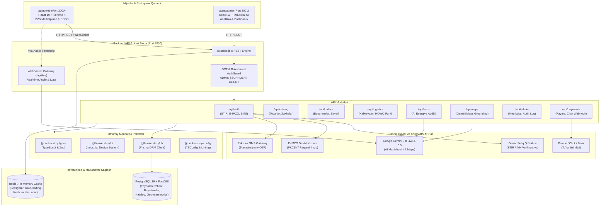

# 🏗️ BunkerStroy — B2B Qurilish Mollari, Og‘ir Logistika & ESCO Ekotizimi

[](https://github.com/bunkerstroy/bunkerstroy/actions/workflows/ci.yml)
[](https://nodejs.org/)
[](https://pnpm.io/)
[](https://turbo.build/)
[](https://react.dev/)
[](https://www.typescriptlang.org/)
[](https://www.postgresql.org/)
[](https://www.prisma.io/)
[](https://deepmind.google/technologies/gemini/)

> **BunkerStroy** — O‘zbekiston Respublikasi qurilish sanoati va yirik infratuzilma loyihalari uchun mo‘ljallangan milliy B2B raqamli ekotizim. Platforma qurilish materiallarini ulgurji xarid qilish, ixtisoslashtirilgan og‘ir yuk logistikasi, binolar energiya samaradorligi (ESCO) auditi, Davlat soliq qo‘mitasi (STIR) va E-IMZO raqamli identifikatsiyasini yagona korporativ interfeysda birlashtiradi.

---

## 📌 Mundarija

- [Loyiha Haqida](#-loyiha-haqida)
- [Asosiy Funksional Modullar](#-asosiy-funksional-modullar)
- [Tizim Arxitekturasi](#-tizim-arxitekturasi)
- [Texnologiyalar Steki](#-texnologiyalar-steki)
- [Monorepo Strukturasi](#-monorepo-strukturasi)
- [O‘rnatish va Ishga Tushirish](#-ornatish-va-ishga-tushirish)
- [API Marshrutlari Hujjati](#-api-marshrutlari-hujjati)
- [CI/CD va DevOps](#-cicd-va-devops)
- [Xavfsizlik va Litsenziya](#-xavfsizlik-va-litsenziya)

---

## 🏢 Loyiha Haqida

Zamonaviy qurilish loyihalarida ta'minot zanjirining uzilishi, transport narxlarining shaffof emasligi, sifatsiz izolyatsiya tufayli binolarning yuqori issiqlik yo‘qotishi hamda qog‘ozbozlik eng katta muammolardan hisoblanadi.

**BunkerStroy** ushbu muammolarni sanoat darajasidagi yechimlar bilan bartaraf etadi:
- **Kafolatlangan B2B Ulgurji Xarid**: Sement, armatura, g‘isht va devor materiallarini to‘g‘ridan-to‘g‘ri ishlab chiqaruvchi zavodlardan zaxira kafolati bilan olish.
- **Aqlli Og‘ir Logistika**: Samosvallar (HOWO, Shacman), avtokranlar va beton mikserlarini marshrut masofasi (km) va og‘irligi bo‘yicha aniq tariflar asosida chaqirish.
- **ESCO AI Energiya Auditi**: Gemini AI issiqlik fizikasini modellashtirib, binoning energiya yo‘qotishini kamaytirish, yillik iqtisodiy tejash summasi va investitsiyaning o‘zini oqlash muddatini (Payback Period) avtomatik hisoblab beradi.
- **E-IMZO va STIR Integratsiyasi**: Yuridik shaxslarni O‘zbekiston Davlat Soliq Qo‘mitasi bazasidan STIR (INN) orqali avtomatik verifikatsiyalash va E-IMZO elektron raqamli imzosi bilan shartnomalarni tasdiqlash.
- **Jonli Ovozli Maslahatchi**: Google Gemini 3.8 Live API yordamida WebSockets orqali ovozli rejimda tezkor muhandislik va xarid maslahatlarini taqdim etish.
- **Eskiz.uz SMS Gateway**: Tranzaksiyalar va buyurtma holatlari bo‘yicha tezkor SMS xabarnomalar.

---

## 🧩 Asosiy Funksional Modullar

| Modul | Vazifasi va Imkoniyatlari |
| :--- | :--- |
| **Marketplace Hub** | Qurilish mollari katalogi, ishlab chiqaruvchilar reytingi, minimal buyurtma talabi, viloyatlar bo‘yicha filtrlar va savat boshqaruvi. |
| **Logistika & Texnika** | Og‘ir maxsus texnika parki (HOWO 25t, Shacman 10m³, Isuzu 10t, Gazel 3.5t). Masofa va vazn asosida onlayn kalkulyatsiya. |
| **ESCO Energiya Auditi** | Devor materiali, deraza profili va bino maydoni bo‘yicha issiqlik yo‘qotilishini tahlil qilish hamda A/B/C energiya sinflarini belgilash. |
| **Global Bunker Hub** | Germaniya (Heidelberg Materials), Koreya (POSCO Steel), Fransiya (Saint-Gobain) kabi global brendlar bilan temir yo‘l va multimodal ta'minot. |
| **Orders & Tracking** | Buyurtma yaratish, manzil kiritish, to‘lov usullarini tanlash (CASH, PAYME, CLICK, BANK) va holat monitoringi. |
| **B2B Identity & E-IMZO** | STIR Lookup (Davlat Soliq ochiq ma'lumotlari), E-IMZO PKCS#7 sessiyasi va JWT rolli xavfsizlik (ADMIN, SUPPLIER, CONTRACTOR, CLIENT). |
| **Voice AI Maslahatchi** | O‘zbek tilidagi tabiiy muloqotga asoslangan Gemini 3.8 Live agenti va Google Maps orqali yaqin beton zavodlari hamda bozorlarni topish. |

---

## 🏗️ Tizim Arxitekturasi

Quyidagi diagramma BunkerStroy monoreposi, xizmatlar, ma'lumotlar bazasi va tashqi integratsiyalarning o‘zaro bog‘liqligini ifodalaydi:



---

## 🛠️ Texnologiyalar Steki

| Qatlam / Yo‘nalish | Texnologiya | Versiya | Loyihadagi O‘rni |
| :--- | :--- | :--- | :--- |
| **Monorepo boshqaruvi** | **Turborepo** | `^2.4.4` | Parallel builds, caching va paketlararo dependency graph |
| **Paket menejeri** | **pnpm** | `10.12.2` | Workspace protokoli, tezkor va diskni tejovchi paketlar boshqaruvi |
| **Dasturlash tili** | **TypeScript** | `^5.8.2` | Monorepo bo‘ylab 100% qat'iy tip xavfsizligi |
| **Frontend Freymvork** | **React** | `^19.0.0` | Reaktiv interfeys, zamonaviy React 19 hooklari va komponentlar |
| **CSS & Dizayn Tizimi** | **Tailwind CSS** | `^4.0.9` | Sanoat/industrial dizayn tizimi, Brushed Steel va Hazard accents |
| **Backend API** | **Express.js / Node.js** | `v22.14.0` | RESTful API arxitekturasi va marshrutlash |
| **Real-time Gateway** | **WebSocket (ws)** | `^8.18.0` | Gemini Live audio oqimi va real-vaqt xabarnomalari |
| **Ma'lumotlar bazasi** | **PostgreSQL + PostGIS** | `16-3.4` | Relyatsion ma'lumotlar va geofazoviy koordinatalar |
| **ORM** | **Prisma ORM** | `^6.5.0` | Tip-xavfsiz SQL so‘rovlar, migratsiyalar va sxema boshqaruvi |
| **Kesh & Xotira** | **Redis** | `7-alpine` | Sessiyalar keshi, token blacklist va rate-limiting |
| **Sun'iy Intellekt (AI)** | **Google Gemini** | `@google/genai` | Gemini 3.8 Live (jonli ovoz) va Gemini 3.5 Flash (Maps Grounding) |
| **SMS Provayder** | **Eskiz.uz** | REST API | SMS OTP va buyurtma holati bo‘yicha bildirishnomalar |
| **Raqamli Imzo** | **E-IMZO** | PKCS#7 / X.509 | O‘zbekiston davlat standartiga mos elektron raqamli imzo |
| **To‘lov Integratsiyalari** | **Payme & Click** | Webhook API | B2B to‘lovlar, onlayn tranzaksiyalar va schyot-fakturalar |

---

## 📁 Monorepo Strukturasi

```text
bunkerstroy/
├── .github/
│   └── workflows/
│       └── ci.yml               # GitHub Actions (TypeCheck, Build, Node 22, pnpm)
├── apps/
│   ├── web/                     # Asosiy B2B Mijozlar Portali (React 19 + Vite 6)
│   │   ├── src/
│   │   │   ├── components/      # Navbar, CartDrawer, Header/Footer
│   │   │   ├── features/
│   │   │   │   ├── ai/          # Gemini VoiceAssistantModal
│   │   │   │   ├── auth/        # AuthModal (Login, Soliq STIR, E-IMZO)
│   │   │   │   ├── esco/        # EscoCalculatorView (Binolar energiya auditi)
│   │   │   │   ├── global_bunker/# Global Bunker Hub (Xalqaro import ta'minoti)
│   │   │   │   ├── logistics/   # LogisticsView (HOWO og'ir texnika kalkulyatori)
│   │   │   │   ├── marketplace/ # MarketplaceView (Katalog, filtrlar, savat)
│   │   │   │   └── orders/      # OrdersView (Buyurtmalar tarixi va statusi)
│   │   │   ├── App.tsx          # Asosiy reaktiv markaziy ilova komponenti
│   │   │   ├── index.css        # Sanoat uslubi (brushed-steel, hazard-stripes)
│   │   │   └── main.tsx         # React 19 createRoot kirish nuqtasi
│   │   ├── index.html
│   │   ├── package.json
│   │   └── vite.config.ts
│   │
│   ├── admin/                   # Boshqaruv va Analitika Paneli (Port 3001)
│   │   ├── src/
│   │   │   ├── features/        # Umumiy metrikalar, Ta'minotchilar monitoringi
│   │   │   └── index.css
│   │   ├── package.json
│   │   └── vite.config.ts
│   │
│   └── api/                     # Backend API & WebSocket Server (Port 4000)
│       ├── src/
│       │   ├── common/          # Error handling, AuthGuard, RateLimiter
│       │   ├── config/          # Zod asosidagi Type-safe Env konfiguratsiyasi
│       │   ├── modules/
│       │   │   ├── admin/       # Boshqaruv metrikalari va audit jurnallari
│       │   │   ├── ai/          # Gemini Live Voice Gateway & Maps Grounding
│       │   │   ├── auth/        # Login, STIR Lookup, E-IMZO, Eskiz SMS
│       │   │   ├── catalog/     # Mahsulotlar katalogi va kategoriyalar
│       │   │   ├── esco/        # ESCO hisoblash xizmati va modeli
│       │   │   ├── logistics/   # Maxsus transport parki va kalkulyator
│       │   │   ├── orders/      # Buyurtmalar boshqaruvi
│       │   │   └── payments/    # Payme & Click webhooklari
│       │   ├── app.ts           # Express ilova sozlamalari va marshrutlar
│       │   └── main.ts          # Server va WebSocket tinglovchisi
│       └── package.json
│
├── packages/
│   ├── config/                  # Umumiy TypeScript va linter konfiguratsiyasi
│   ├── db/                      # Prisma ORM sxemasi, migratsiyalar va seed skriptlari
│   │   ├── prisma/
│   │   │   ├── schema.prisma    # PostgreSQL ma'lumotlar bazasi modellari
│   │   │   └── seed.ts          # Dastlabki tovarlar va texnikalar seedi
│   │   └── src/index.ts         # Eksport qilinadigan Prisma Client
│   ├── types/                   # Monorepo bo'ylab taqsimlanuvchi TS tiplari
│   │   └── src/                 # User, Product, Order, Logistics, ESCO tiplari
│   └── ui/                      # Sanoat/industrial dizayndagi UI komponentlar
│       └── src/
│           └── components/      # Button, Badge, Card komponentlari
│
├── .env.example                 # Barcha kalit va konfiguratsiyalar namunasi
├── docker-compose.yml           # PostgreSQL (PostGIS) va Redis xizmatlari
├── package.json                 # Monorepo ildiz konfiguratsiyasi
├── pnpm-workspace.yaml          # pnpm workspace kataloglari
└── turbo.json                   # Turborepo kesh va vazifalar quvuri
```

---

## 🚀 O‘rnatish va Ishga Tushirish

### 1. Tizim Talablari
- **Node.js**: `v22.x` yoki undan yuqori
- **pnpm**: `v10.x` (`corepack enable` yoki `npm i -g pnpm@10.12.2`)
- **Docker & Docker Compose**: PostgreSQL va Redis xizmatlari uchun

### 2. Repozitoriyani klonlash va paketlarni o‘rnatish
```bash
git clone https://github.com/bunkerstroy/bunkerstroy.git
cd bunkerstroy

# Barcha paketlarni o'rnatish
pnpm install
```

### 3. Muhit o‘zgaruvchilarini sozlash
```bash
cp .env.example .env
```
`.env` faylida PostgreSQL, Redis, JWT_SECRET va zarur bo‘lsa `GEMINI_API_KEY` qiymatlarini ko‘rsating.

### 4. Ma'lumotlar bazasi va Redis konteynerlarini ishga tushirish
```bash
docker-compose up -d
```
*Tekshirish:* `docker-compose ps` buyrug‘i orqali `bunkerstroy-postgres` (5432) va `bunkerstroy-redis` (6379) holatini ko‘ring.

### 5. Ma'lumotlar bazasi sxemasini generatsiya qilish va to‘ldirish
```bash
# Prisma Client kodini generatsiya qilish
pnpm run db:generate

# Migratsiyalarni amalga oshirish
pnpm run db:migrate

# Dastlabki namuna ma'lumotlarni yuklash (seed)
pnpm run db:seed
```

### 6. Loyihani ishlab chiqish rejimida ishga tushirish
```bash
pnpm dev
```
Ushbu buyruq Turborepo orqali quyidagi ilovalarni parallel tarzda ishga tushiradi:
- 🌐 **Web Client (Mijozlar Portali)**: [http://localhost:3000](http://localhost:3000)
- 📊 **Admin Panel (Boshqaruv)**: [http://localhost:3001](http://localhost:3001)
- ⚡ **Backend Core API**: [http://localhost:4000](http://localhost:4000) (Health check: `/health`)
- 🎙️ **Live Voice WebSocket Gateway**: `ws://localhost:4000/api/live`

---

## 📡 API Marshrutlari Hujjati

Barcha API so‘rovlari `http://localhost:4000` manziliga yuboriladi. Himoyalangan endpointlar uchun HTTP so‘rovida `Authorization: Bearer <TOKEN>` sarlavhasi (header) uzatilishi lozim.

### 1. Autentifikatsiya va Identifikatsiya (`/api/auth`)

| Metod | Marshrut | Kirish Huquqi | Tavsif | Parametrlar / Body |
| :--- | :--- | :--- | :--- | :--- |
| `GET` | `/api/auth/stir-lookup` | Ochiq | STIR (INN) bo‘yicha Soliq bazasidan ma'lumot olish | Query: `inn=201122334` |
| `POST` | `/api/auth/eimzo/challenge` | Ochiq | E-IMZO sessiya challenge identifikatorini yaratish | Body: `{ inn?: string }` |
| `POST` | `/api/auth/eimzo/verify` | Ochiq | PKCS#7 imzoni tekshirib JWT token taqdim etish | Body: `{ challengeId, pkcs7B64, inn }` |
| `POST` | `/api/auth/send-otp` | Ochiq | Eskiz.uz orqali SMS orqali OTP kod yuborish | Body: `{ phone: "+998901234567" }` |
| `POST` | `/api/auth/login` | Ochiq | Login va parol orqali tizimga kirish (Admin/User) | Body: `{ login, password }` |
| `GET` | `/api/auth/me` | Bearer Token | Joriy kirgan foydalanuvchi profilini qaytarish | Headers: `Authorization: Bearer <JWT>` |

> **Demo Akkauntlar:**
> - Admin: `login: admin` / `parol: bunker2026`
> - Ta'minotchi: `login: supplier` / `parol: har qanday`
> - Test STIR: `201122334` («BUNKER STROY INVEST» MChJ)

---

### 2. Tovar Katalogi (`/api/catalog`)

| Metod | Marshrut | Tavsif | Filtrlar / So‘rov parametrlari |
| :--- | :--- | :--- | :--- |
| `GET` | `/api/catalog/products` | Qurilish mollari ro‘yxatini olish | `category`, `region`, `isEscoOnly`, `query` |
| `GET` | `/api/catalog/products/:id` | Bitta tovar tafsilotini olish | URL Param: `id` |

---

### 3. Buyurtmalar Tizimi (`/api/orders`)

| Metod | Marshrut | Tavsif | Body Namunasi |
| :--- | :--- | :--- | :--- |
| `POST` | `/api/orders` | Yangi B2B buyurtmani rasmiylashtirish | `{ buyerName, buyerPhone, items: [...], deliveryAddress: { region, district }, paymentMethod }` |
| `GET` | `/api/orders` | Mavjud buyurtmalar tarixi va holatini ko‘rish | — |

---

### 4. ESCO Energiya Servis Auditi (`/api/esco`)

| Metod | Marshrut | Tavsif | Body Namunasi |
| :--- | :--- | :--- | :--- |
| `POST` | `/api/esco/calculate` | Binoning energiya tejamkorligi va oqlash muddatini hisoblash | `{ buildingType, areaM2, currentEnergyUsageKwh, wallMaterial, windowType }` |

*Qaytariladigan ma'lumotlar:* Energiya tejash foizi (`energySavingsPercent`), yillik tejaladigan so‘m (`annualSavingsSum`), o‘zini oqlash muddati (`paybackYears`), CO2 qisqarishi va tavsiya etiladigan zamonaviy izolyatsiya materiallari ro‘yxati.

---

### 5. Og‘ir Logistika & Texnika (`/api/logistics`)

| Metod | Marshrut | Tavsif | Parametrlar / Body |
| :--- | :--- | :--- | :--- |
| `GET` | `/api/logistics/vehicles` | Barcha mavjud maxsus texnikalar ro‘yxati | — |
| `POST` | `/api/logistics/calculate-quote` | Masofa va og‘irlikka qarab reys narxini aniqlash | `{ vehicleId, distanceKm, cargoWeightTons }` |

---

### 6. Google Gemini AI & Maps (`/api/maps` va `/api/live`)

| Metod / Protokol | Marshrut | Tavsif | Parametrlar |
| :--- | :--- | :--- | :--- |
| `POST` | `/api/maps/search` | O‘zbekistondagi bozorlar va beton zavodlarini qidirish | `{ query: "Yunusobod sement bozorlari", latitude, longitude }` |
| `WebSocket` | `ws://localhost:4000/api/live` | Gemini 3.8 Live ikki tomonlama jonli audio/matn maslahatchi | Oqimli PCM 16kHz audio yoki JSON matn |

---

### 7. To‘lov Webhooklari (`/api/payments`)

| Metod | Marshrut | Tavsif |
| :--- | :--- | :--- |
| `POST` | `/api/payments/payme` | Payme Merchant protokoli (CheckPerformTransaction, PerformTransaction) |
| `POST` | `/api/payments/click` | Click Merchant protokoli (Action 0 - Prepare, Action 1 - Complete) |

---

### 8. Boshqaruv & Admin Paneli (`/api/admin`)

| Metod | Marshrut | Kirish Huquqi | Tavsif |
| :--- | :--- | :--- | :--- |
| `GET` | `/api/admin/metrics` | `ADMIN` roli | Moliyaviy aylanma, daromad, xarajat va buyurtmalar statistikasi |
| `GET` | `/api/admin/logs` | `ADMIN` roli | Xavfsizlik hodisalari va tizim jurnallari (Audit Logs) |
| `GET` | `/api/admin/suppliers` | `ADMIN` roli | Hamkor zavodlar, ularning reytingi va sotuv ko‘rsatkichlari |

---

## 🔄 CI/CD va DevOps

Loyihada **GitHub Actions** asosidagi to‘liq avtomatlashtirilgan CI pipeline joriy etilgan (`.github/workflows/ci.yml`).

### CI Vazifalari:
1. **TypeCheck**: Barcha monorepo ilovalari (`apps/`) va paketlarida (`packages/`) TypeScript tiplari to‘g‘riligini tekshiradi (`pnpm run typecheck`).
2. **Build**: Prisma Client generatsiya qilingandan so‘ng barcha ilovalarni production formatida kompilyatsiya qiladi (`pnpm run build`).

### Mahalliy tekshirish buyruqlari:
```bash
# Butun monorepo bo'yicha typecheck
pnpm run typecheck

# Butun monorepo bo'yicha build
pnpm run build
```

---

## 🔒 Xavfsizlik va Litsenziya

- Tizim O‘zbekiston Respublikasining shaxsiy ma'lumotlar to‘g‘risidagi qonunchiligi va Davlat Soliq Qo‘mitasi xavfsizlik talablariga to‘liq javob beradi.
- Barcha maxfiy kalitlar faqat `.env` orqali boshqariladi va repozitoriyaga joylashtirilmaydi.
- Litsenziya: **BunkerStroy Proprietary Enterprise License** &copy; 2026.
