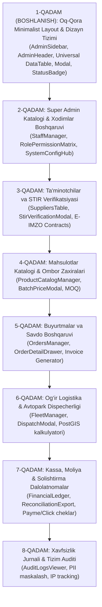

# 📋 TEXNIK VAZIFA (TZ) — BunkerStroy B2B Admin Boshqaruv Paneli

**Loyiha:** `BunkerStroy Enterprise Admin Dashboard`  
**Yo‘nalish:** B2B Qurilish Mollari, Og‘ir Logistika va Kassa Nazorati  
**Dasturlash Freymvorki:** `React 19 + TypeScript (Vite)`  
**Dizayn Tizimi:** `Oq-qora (Monochrome Minimalist) Industrial Clean UI`  
**Hujjat versiyasi:** `1.1.0-ADMIN-ENTERPRISE`  
**Holati:** Tasdiqlangan / Dasturlash bosqichida  

---

## 📌 1. Loyihaning Maqsadi va Asosiy Qoidalari

**BunkerStroy Admin Paneli** — O‘zbekiston qurilish agregatori ekotizimining markaziy boshqaruv interfeysi bo‘lib, platformaning moliyaviy oqimlari, yirik yetkazib beruvchilari, zaxiralari, buyurtmalari hamda maxsus og‘ir texnika transportlarini to‘liq nazorat qilishga mo‘ljallangan.

### 🎯 Qat'iy Arxitektura va Dizayn Prinsiplari:
1. **React 19 Ekosistemasi**: Dastur React 19, TypeScript 5.8 va Vite asosida eng yuqori unumdorlik bilan ishlaydi.
2. **Oq-Qora Minimalist UI/UX**: Chalg‘ituvchi ortiqcha ranglar, murakkab gradientlar va effektlarsiz toza, qat'iy oq-qora (Black & White monochrome), yuqori kontrastli va qulay ma'lumotlar jadvallari (Data-dense tables).
3. **Super Admin Katalogi**: Tizim ma'murlari, xodimlar rollari va platforma darajasidagi barcha ruxsatlarni boshqaruvchi maxsus katalog mavjud.
4. **ESCO Modulining Chiqarilishi**: ESCO auditorlik tekshiruvi admin panel doirasidan chiqarilgan, diqqat faqat B2B savdo, logistika, moliya va xavfsizlikka qaratilgan.

---

## 🎨 2. UX/UI Sanoat Standartlari (Catppuccin Slate & Latte Dizayn Tizimi)

Admin panelining barcha sahifalari foydalanuvchi kompyuter muhiti bilan to‘liq uyg‘unlashgan **Catppuccin Slate & Latte** dual-mode palitrasi hamda Senior B2B prinsiplari asosida ishlanadi:

### 2.1. Dual-Mode Palitra Standartlari:
| Element | Dark Mode (Mocha Slate) | Light Mode (Latte Clean) | Vazifasi / Maqsadi |
| :--- | :--- | :--- | :--- |
| **Asosiy Fon (Main BG)** | `#181825` (Chuqur mot slate) | `#EFF1F5` (Yumshoq neytral oq) | Ko‘zni charchatmaydigan tekis fon |
| **Kartochkalar & Bloklar** | `#1E1E2E` (Catppuccin Base) | `#FFFFFF` (Toza oq) | Fon bilan 1px chegarada ajraluvchi kartalar |
| **Ichki Kichik Bloklar** | `#252538` | `#E6E9EF` | Jadval sarlavhasi, ichki vidjetlar |
| **Chegaralar (Borders)** | `#313244` / `#45475A` | `#CCD0DA` / `#BCC0CC` | Aniq 1px pikselli ajratgichlar |
| **Asosiy Matn (Primary)** | `#CDD6F4` | `#4C4F69` | Yuqori o‘qiluvchanlik |
| **Yordamchi Matn (Muted)** | `#A6ADC8` | `#6C6F85` | Subtitrlar, sanalar, tushuntirishlar |
| **Birlamchi Aksent (Action)** | `#89B4FA` (Safir ko‘k) | `#1E66F5` (Moviy) | Asosiy harakat tugmalari, faol tablar |
| **Muvaffaqiyat (Success)** | `#A6E3A1` (Yumshoq yashil) | `#40A02B` | Tasdiqlangan STIR, to‘langan kassa |
| **Ogohlantirish (Warning)** | `#F9E2AF` (Yumshoq sarg‘ish) | `#DF8E1D` | Kutilayotgan modallik, kam qolgan zaxira |
| **Xavf / Bekor (Danger)** | `#F38BA8` (Yumshoq qizil) | `#D20F39` | Bloklash, rad etish, xavfli o‘chirish |

### 2.2. Senior Dizayn va Ergonomika Qoidalari:
1. **Data Density (Axborot Zichligi)**: 36px–42px kompakt satrlar, monospaced raqamlar (`JetBrains Mono`).
2. **Master-Detail (Slide-Over Drawer)**: Har qanday element tafsiloti asosiy jadvaldan chiqib ketmasdan o‘ng tomondan ochiluvchi yon paneldan (`SlideOverDrawer`) boshqariladi.
3. **Keyboard-First Tajriba**: `Esc` barcha oynalarni yopadi, `Enter` qidiradi, `Ctrl+K` tezkor amallar palitrasini ochadi.
4. **Signal Colors**: Ranglar faqat holat va ma'noni bildirish uchun qo‘llaniladi, ortiqcha chalg‘ituvchi bezaklar man etiladi.

---

## 👥 3. Ruxsatlar va Rollar Matritsasi (RBAC)

Admin paneliga kirish qat'iy rollar asosida boshqariladi:

| Modul | Super Admin | Boshqaruvchi (Admin) | Moliyachi (Finance) | Logistika Dispecheri |
| :--- | :---: | :---: | :---: | :---: |
| **Super Admin Katalogi** | ✅ To‘liq huquq | ❌ Ruxsat yo‘q | ❌ Ruxsat yo‘q | ❌ Ruxsat yo‘q |
| **Ta'minotchilar & STIR** | ✅ To‘liq huquq | ✅ Tasdiqlash/Ko‘rish | 👁️ Faqat ko‘rish | ❌ Ruxsat yo‘q |
| **Mahsulotlar & Zaxira** | ✅ To‘liq huquq | ✅ Tahrirlash/Boshqarish | 👁️ Faqat narxlar | ❌ Ruxsat yo‘q |
| **Buyurtmalar & Savdo** | ✅ To‘liq huquq | ✅ To‘liq boshqaruv | ✅ Holat/To‘lov | 👁️ Manzil/Muddati |
| **Og‘ir Logistika & Texnika** | ✅ To‘liq huquq | ✅ Biriktirish/Ko‘rish | 👁️ Faqat yo‘l haqi | ✅ Texnika biriktirish |
| **Kassa & Moliyaviy Jurnal** | ✅ To‘liq huquq | 👁️ Faqat hisobotlar | ✅ To‘liq boshqaruv | ❌ Ruxsat yo‘q |
| **Xavfsizlik Jurnali (Audit)** | ✅ To‘liq huquq | 👁️ Faqat o‘z amallari | ❌ Ruxsat yo‘q | ❌ Ruxsat yo‘q |

---

## 🧩 4. Funksional Modullar Texnik Vazifasi

---

### 4.1. 👑 Modul 1: Super Admin Katalogi & Tizim Boshqaruvi
Super Admin uchun platformaning eng muhim yadrosi bo‘lib, quyidagi bo‘limlardan iborat:

1. **Ma'murlar va Xodimlar Ro‘yxati (`/admin/super/staff`)**:
   - Platformadagi barcha xodimlarni boshqarish: Super Admin, Boshqaruvchi, Moliyachi, Dispecher.
   - Yangi ma'mur qo‘shish (Ism, Telefon, Email, Rol, Maxsus ruxsatlar).
   - Xodim hisobini bir zumda muzlatish (`BLOCK`) yoki blokdan chiqarish (`ACTIVE`).
2. **Tizim Rol va Ruxsatlar Konstruktori (`/admin/super/roles`)**:
   - Dinamik ruxsatlar matritsasi (masalan, "Katalog narxlarini o‘zgartirish huquqi", "Pul o‘tkazmalarini tasdiqlash huquqi").
3. **Global Tizim Konfiguratsiyasi (`/admin/super/config`)**:
   - Texnik xizmat rejimi (`Maintenance Mode: ON/OFF`).
   - Tashqi xizmatlar statusi (Soliq STIR API, E-IMZO, Eskiz SMS, Payme/Click gateway holatlari).
   - Zaxira nusxalar (Database Backup) holati va oxirgi nusxa olingan vaqt.

---

### 4.2. 🏢 Modul 2: Ta'minotchilar va STIR Verifikatsiyasi
Qurilish materiallarini yetkazib beruvchi zavod va korxonalarni tekshirish:

1. **Yuridik Shaxslar Reyestri**:
   - Ma'lumotlar: Korxona nomi, 9 xonali STIR (INN), Rahbari, Yuridik manzili, Viloyati, Faoliyat turi, QQS to‘lovchisi maqomi.
   - Holatlar: `VERIFIED` (Tasdiqlangan), `PENDING_REVIEW` (Ko‘rib chiqilmoqda), `SUSPENDED` (To‘xtatilgan).
2. **Onlayn STIR Qidiruvi**:
   - Admin STIR raqamini kiritganda Davlat Soliq Qo‘mitasi bazasidan ma'lumotlarni tortib olish va solishtirish.
3. **E-IMZO Shartnomalari**:
   - B2B ta'minotchi bilan tuzilgan bosh kelishuv (General Contract) va uning PKCS#7 raqamli imzo sertifikatini ko‘rish.

---

### 4.3. 🧱 Modul 3: Mahsulotlar Katalogi va Zaxiralar Boshqaruvi
Qurilish materiallarining ulgurji nomenklaturasi va ombor qoldiqlari:

1. **Mahsulotlar Jadvali**:
   - Mahsulot nomi, Kategoriya (Sement, Armatura, G‘isht va h.k.), Ta'minotchi korxona, Baza narxi, O‘lchov birligi (`qop`, `tonna`, `m²`), Ombor zaxirasi soni.
2. **Minimal Buyurtma Miqdori (MOQ)**:
   - Har bir tovar bo‘yicha ulgurji sotish minimal chegarasi (masalan, kamida 20 qop yoki 2 tonna).
3. **Zaxira Kamayishi Haqida Ogohlantirish**:
   - Ombor qoldig‘i belgilangan xavfli minimumdan pastga tushganda satrning alohida belgilanishi (`LOW_STOCK`).
4. **Ommaviy Narx O‘zgartirish (Batch Price Update)**:
   - Zavod narxlari o‘zgarganda bir vaqtning o‘zida tanlangan tovarlar narxini foizda yoki aniq summada oshirish/kamaytirish.

---

### 4.4. 📦 Modul 4: Buyurtmalar va Shartnomalar Boshqaruvi
Barcha B2B xaridlarning hayotiy davri:

1. **Buyurtmalar Monitoringi**:
   - Buyurtma raqami (`BS-ORD-XXXX`), Buyurtmachi korxona, Tovarlar soni, Umumiy summa, Yetkazib berish manzili, Sanasi.
2. **Holatlar Zanjiri (Order Lifecycle)**:
   - `NEW` (Yangi) ➡️ `CONFIRMED` (Tasdiqlangan) ➡️ `PAID` (To‘langan) ➡️ `DISPATCHED` (Yo‘lda) ➡️ `DELIVERED` (Yetkazildi) ➡️ `COMPLETED` (Yakunlandi).
3. **CWE-472 Xavfsizlik Qoidasi**:
   - Buyurtma ichidagi mahsulot narxi faqat server tomonidan tasdiqlangan summa bo‘yicha ko‘rsatiladi. Admin orqali qo‘shimcha kelishilgan chegirmalar faqat ruxsatli ma'murlar tomonidan kiritiladi.
4. **Hisob-faktura (Invoicing)**:
   - Buyurtma bo‘yicha to‘lov hisob-kitob varaqasini bitta tugma orqali ko‘rish va chop etish/PDF qilish.

---

### 4.5. 🚛 Modul 5: Og‘ir Logistika va Avtopark Dispecherligi
HOWO, Shacman va boshqa maxsus og‘ir texnikalar parki:

1. **Avtopark Jadvali**:
   - Texnika nomi (masalan, *HOWO Sinotruk 25t*, *Shacman Mikser 10m³*), Davlat raqami, Haydovchi ismi va telefoni, Sig‘imi (Tonna/m³).
   - Holati: `AVAILABLE` (Bo‘sh), `ON_ROUTE` (Marshrutda), `MAINTENANCE` (Ta'mirda).
2. **Dispecherlik Biriktiruvi (Dispatch Assign)**:
   - Kelib tushgan buyurtmaga eng yaqin bo‘sh samosval yoki mikserni biriktirish.
3. **Marshrut va Narx Hisobi**:
   - PostGIS masofasi (km) va bazaviy stavka bo‘yicha transport xarajati hisobi.

---

### 4.6. 💳 Modul 6: Kassa, Moliya va To‘lovlar Rekonsilyatsiyasi
Barcha pul oqimlari va fintech integratsiyalari:

1. **Tranzaksiyalar Jurnali**:
   - Tranzaksiya ID, Buyurtma raqami, To‘lov tizimi (`PAYME`, `CLICK`, `BANK_TRANSFER`), Summa, Holati (`PAID`, `PENDING`, `FAILED`, `REFUNDED`), Vaqt.
2. **To‘lov Tafsilotlari**:
   - Payme tranzaksiya identifikatori (`paycom_transaction_id`) yoki Click MD5 chek tekshiruvi.
3. **Solishtirma Dalolatnoma (Act Sverki)**:
   - Ma'lum korxona yoki ta'minotchi bilan belgilangan davr oralig‘ida barcha hisob-kitoblarni Excel (XLSX) yoki CSV formatida yuklab olish.

---

### 4.7. 🛡️ Modul 7: Xavfsizlik Jurnali va Tizim Auditi (Audit Trail)
Tizimda bajarilgan har bir nozik harakatni qayd etish:

1. **AuditLog Jadvali**:
   - Vaqti (Toshkent vaqti bilan soniyasigacha), Bajaruvchi shaxs (Ism, Rol, STIR), Amal turi (`PRICE_CHANGE`, `USER_BLOCK`, `ORDER_CANCEL`, `EIMZO_VERIFY`), IP Manzili, Tafsilotlar.
2. **PII (Shaxsiy Ma'lumotlar) Himoyasi**:
   - Telefon raqamlar va pasport ma'lumotlari ruxsati bo‘lmagan xodimlar uchun niqoblangan holda (`+998 90 *** ** 67`) taqdim etiladi.

---

## 💻 5. React 19 Frontend Arxitekturasi va Fayllar Strukturasi

Loyiha [`apps/admin`](file:///home/sadullaef-arch/bunkerstroy/apps/admin) papkasida quyidagi qat'iy modulli arxitektura bo‘yicha tashkil etiladi:

```text
apps/admin/src/
├── main.tsx                         # Dasturga kirish nuqtasi
├── App.tsx                          # Asosiy Layout, Catppuccin dual-mode va Tab router
├── index.css                        # Tailwind 4 va Catppuccin dizayn tizimi
├── components/                      # 🧱 4-QAVATLI KOMPONENTLAR ARXITEKTURASI
│   │
│   ├── [Qatlam 1: Atomik Primitivlar]
│   │   ├── Button.tsx               # Primary (#89B4FA), Secondary, Danger, Ghost tugmalar
│   │   ├── Input.tsx                # Matn, qidiruv va parol kiritish maydoni (ikonka bilan)
│   │   ├── Select.tsx               # Rol va filtrlash ochiluvchi menyusi
│   │   ├── Switch.tsx               # Yoqish/O'chirish (Toggle) tugmachasi
│   │   ├── StatusBadge.tsx          # [ACTIVE], [PENDING], [BLOCKED] teglari
│   │   └── Skeleton.tsx             # Silliq pulsatsiyalanuvchi yuklanish joylari
│   │
│   ├── [Qatlam 2: Murakkab Boshqaruv Vidjetlari]
│   │   ├── DataTable.tsx            # Qidiruv, saralash, 300ms debounce, sahifalash
│   │   ├── SlideOverDrawer.tsx      # O'ng tomondan silliq ochiluvchi tafsilotlar paneli
│   │   ├── ConfirmModal.tsx         # Xavfli amallarni tasdiqlash dialogi
│   │   └── KpiStatCard.tsx          # Aylanma, daromad va mini-trend kartochkasi
│   │
│   └── [Qatlam 4: Global Qobiq & Layout]
│       ├── AdminSidebar.tsx         # Catppuccin monoxrom bosh menyu
│       └── AdminHeader.tsx          # Soat, Super Admin nishoni, Mavzu tugmasi
│
└── features/                        # 🏗️ QATLAM 3: Domen Funksional Modullari
    ├── super_admin/                 # 👑 1. Super Admin Katalogi
    │   ├── StaffManager.tsx         # Xodimlar va ma'murlar nazorati
    │   ├── StaffFormModal.tsx       # Yangi xodim qo'shish formasi
    │   ├── RolePermissionMatrix.tsx # Rollar va ruxsatlar matritsasi
    │   └── SystemConfigHub.tsx      # Tizim konfiguratsiyasi va integratsiyalar holati
    ├── suppliers/                   # 🏢 2. Ta'minotchilar va STIR
    │   ├── SuppliersTable.tsx       # Korxonalar ro‘yxati
    │   └── StirDetailDrawer.tsx     # Soliq STIR va E-IMZO shartnomalari
    ├── products/                    # 🧱 3. Mahsulotlar & Zaxira
    │   ├── ProductCatalogManager.tsx# Tovar katalogi jadvali
    │   └── BatchPriceModal.tsx      # Ommaviy narx o‘zgartirish
    ├── orders/                      # 📦 4. Buyurtmalar
    │   ├── OrdersManager.tsx        # Buyurtmalar nazorati
    │   └── OrderDetailDrawer.tsx    # Buyurtma shartnomasi va hisob-faktura
    ├── logistics/                   # 🚛 5. Og‘ir Logistika
    │   ├── FleetManager.tsx         # HOWO/Shacman texnikalar parki
    │   └── DispatchModal.tsx        # Buyurtmaga samosval biriktirish
    ├── financial/                   # 💳 6. Kassa va Tranzaksiyalar
    │   ├── FinancialLedger.tsx      # Kirim-chiqim jurnali
    │   └── ReconciliationExport.tsx # Solishtirma dalolatnoma (Act sverki) eksporti
    └── audit_logs/                  # 🛡️ 7. Xavfsizlik Jurnali
        └── AuditLogsViewer.tsx      # Tizim audit jurnali qidiruvi
```

---

## ⚡ 6. API Integratsiyasi va Backend Shartnomasi

Admin paneli [`apps/api`](file:///home/sadullaef-arch/bunkerstroy/apps/api) backendiga quyidagi asosiy endpointlar orqali ulanadi:

| Metod | Marshrut | Vazifasi | Ruxsat |
| :--- | :--- | :--- | :--- |
| `GET` | `/api/admin/metrics` | Kassa, zaxira va buyurtmalar statistikasi | `ADMIN`, `SUPER_ADMIN` |
| `GET/POST` | `/api/admin/staff` | Ma'muriy xodimlar ro‘yxati va yangi xodim qo‘shish | `SUPER_ADMIN` |
| `PATCH` | `/api/admin/staff/:id/status` | Xodimni bloklash / faollashtirish | `SUPER_ADMIN` |
| `GET` | `/api/admin/suppliers` | Yuridik shaxslar va ta'minotchilar reyestri | `ADMIN`, `SUPER_ADMIN` |
| `POST` | `/api/admin/suppliers/verify` | STIR orqali korxonani tasdiqlash | `ADMIN`, `SUPER_ADMIN` |
| `GET` | `/api/catalog/products` | Tovar zaxiralari va narxlari | Barchaga |
| `PATCH` | `/api/catalog/products/:id` | Tovar narxi va zaxirasini yangilash | `ADMIN`, `SUPER_ADMIN` |
| `GET` | `/api/orders` | Buyurtmalar ro‘yxati va holatlar zanjiri | `ADMIN`, `FINANCE`, `SUPER_ADMIN` |
| `PATCH` | `/api/orders/:id/status` | Buyurtma holatini yangilash | `ADMIN`, `SUPER_ADMIN` |
| `GET` | `/api/logistics/vehicles` | Og‘ir texnikalar ro‘yxati | `LOGISTICS`, `ADMIN`, `SUPER_ADMIN` |
| `POST` | `/api/logistics/dispatch` | Buyurtmaga transport biriktirish | `LOGISTICS`, `ADMIN`, `SUPER_ADMIN` |
| `GET` | `/api/payments/transactions` | Barcha kassa tranzaksiyalari | `FINANCE`, `SUPER_ADMIN` |
| `GET` | `/api/admin/logs` | Tizim xavfsizlik va audit jurnali | `SUPER_ADMIN` |

---

## 📅 7. Ishlab Chiqishning Aniq Ketma-Ketligi (Qaysi biridan boshlaymiz?)

Ishlab chiqish tartibi tasodifiy emas, balki qat'iy mantiqiy bog‘liqlik (dependency tree) asosida quyidagicha boshlanadi:



### 🎯 Nega aynan 1-QADAM (Oq-Qora Minimalist Layout) dan boshlaymiz?
1. Qolgan barcha bo‘limlar aynan shu umumiy oq-qora layout, jadvallar (`DataTable`), modallar va monoxrom status teglari ustiga quriladi.
2. Poydevor toza bo‘lsa, keyingi har bir bo‘limni yaratish va tekshirish 3 barobar tezlashadi va dizaynda nomutanosiblik bo‘lmaydi.

---

## 🔬 8. Har Bir Bo‘lim Uchun 10 Bosqichli Standart Kuchli Tekshiruv Protokoli

Har bir bo‘lim (modul) ishlab chiqilib yakunlangach, to‘g‘ridan-to‘g‘ri keyingisiga o‘tilmaydi. Foydalanuvchining buyrug‘iga asosan quyidagi **10 bosqichli qat'iy tekshiruv** navbatma-navbat o‘tkaziladi:

| Bosqich # | Bosqich Nomi | Tekshiruv Mazmuni va Qat'iy Mezonlari |
| :---: | :--- | :--- |
| **1** | **TypeScript & Tiplar Butunligi Tekshiruvi** | `pnpm --filter @bunkerstroy/admin typecheck` buyrug‘i xatosiz o‘tishi (`0 errors`). Hech qanday `any`, chala interfeys yoki mos kelmaydigan tiplar bo‘lmasligi shart. |
| **2** | **Oq-Qora (Monochrome) UX/UI Dizayn Auditi** | Barcha ranglar qat'iy oq-qora (`#0D0E10`, `#FFFFFF`, `#16181B`, `#2B2F36`). Chalg‘ituvchi yashil/qizil/sariq fonlar va ortiqcha gradientlar yo‘qligi, yuqori kontrast va toza chegaralar mavjudligi. |
| **3** | **React 19 Reaktivlik & State Butunligi** | State boshqaruvi to‘g‘ri ishlashi, ortiqcha renderlar (infinite loop, unnecessary re-render) yo‘qligi, `useEffect` tozalash funksiyalari to‘g‘ri yozilganligi. |
| **4** | **Data Modeling & DTO Validatsiyasi** | Moduldagi barcha ma'lumotlar backend DTO va Prisma sxemalariga (`schema.prisma`) 100% mos kelishi, majburiy va ixtiyoriy maydonlarning aniqligi. |
| **5** | **Edge Cases & Xatoliklarni Boshqarish (Error Handling)** | Bo‘sh holat (Empty state: ma'lumot yo‘q bo‘lganda chiroyli xabar), noto‘g‘ri qidiruv so‘rovi, tarmoq uzilishi (Network failure) va 400/404/500 xatolarida interfeys sinmasligi. |
| **6** | **API & Server Bilan Haqiqiy Integratsiya** | Mock emas, backend API bilan real aloqa (GET, POST, PATCH, DELETE). Serverdan kelgan xatolik xabarlarining aniq ko‘rsatilishi. |
| **7** | **Moslashuvchanlik (Responsive & Layout Stress Test)** | Katta ekran (1920px), noutbuk (1366px), planshet va mobil ekranda jadvallar buzilmasligi, gorizontal scroll to‘g‘ri ishlashi. |
| **8** | **Xavfsizlik va Ruxsatlar (RBAC & PII Defense)** | Ruxsati bo‘lmagan rollar uchun tugmalar bloklanishi yoki ko‘rinmasligi, shaxsiy ma'lumotlar (telefon, STIR) maskirovkasi, XSS kiritishlariga qarshi himoya. |
| **9** | **Tezlik va Unumdorlik (Performance & Debounce)** | Katta jadvallarda (100+ qator) tezlik tushib ketmasligi, qidiruv inputida `debounce` (kamida 300ms) ishlashi, pagination tezkorligi. |
| **10** | **E2E Foydalanuvchi Senariysi & Yakuniy Qabul Testi (Acceptance Test)** | Real foydalanuvchi qadamma-qadam amallarni bajarishi: qo‘shish ➡️ qidirish ➡️ tahrirlash ➡️ tasdiqlash ➡️ natijani tekshirish. Barcha tugmalar va modallar 100% ishlashi. |

---

## 🚦 9. Tekshiruvni Boshqarish Tartibi (Foydalanuvchi Buyruqlari)

Har bir bo‘lim yakunlanganda tizim quyidagi tartibda ishlaydi:

1. **Bo‘lim tayyor bo‘lishi:** Men modul to‘liq yozib tugatilgani haqida hisobot beraman.
2. **Foydalanuvchi buyrug‘i:** Siz menga navbatma-navbat buyruq berasiz:
   - *"1-bosqichli tekshiruvni boshla"* ➡️ Men TypeScript va statik tahlilni to‘liq tekshirib, xatoliklar yo‘qligini isbotlovchi natijani beraman.
   - *"2-bosqichli tekshiruvni boshla"* ➡️ Oq-qora dizayn auditini o‘tkazaman.
   - ...shu tariqa **10-bosqich**gacha har bir sinovdan o‘tiladi.
3. **Barcha 10 ta bosqich muvaffaqiyatli topshirilgandan so‘ngina** keyingi bo‘limga start beriladi!

---
*Ushbu Texnik Vazifa BunkerStroy Admin Panelining barcha vizual, mantiqiy, sifat nazorati va xavfsizlik standartlarini belgilovchi rasmiy dasturilamal hisoblanadi.*
